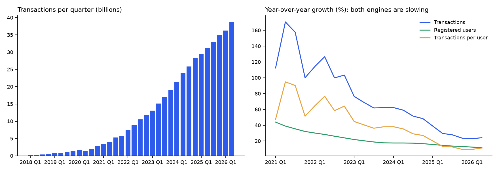
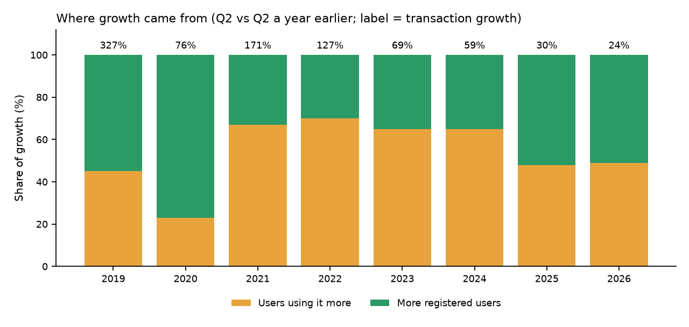
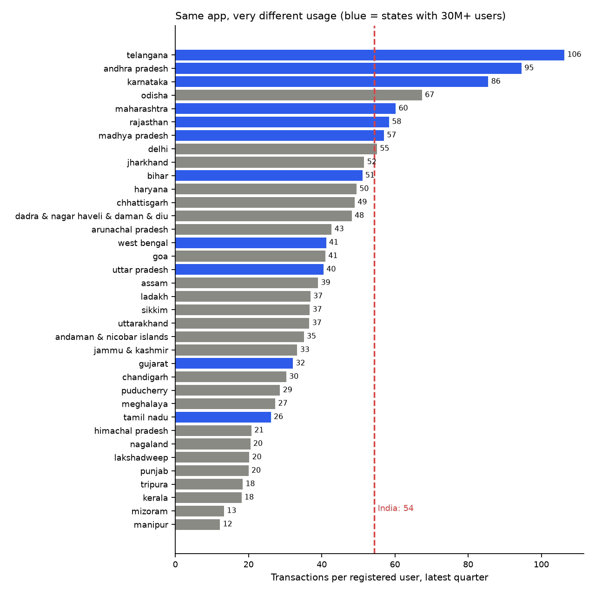
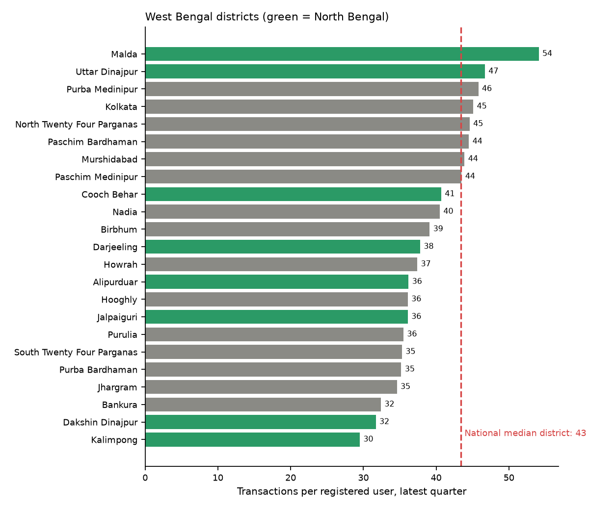

# India's digital payments: where does the next growth come from?

[](https://github.com/Saagnik-Mondal/india-payments-product-case/actions/workflows/ci.yml)

A product case study built from [PhonePe Pulse](https://github.com/PhonePe/pulse), the open dataset PhonePe publishes on payments in India: transactions, registered users and registered merchants for every state and district, every quarter from 2018 to mid-2026.

**The product question:** growth is slowing. If you owned growth for a payments app, where would you invest next: more users, deeper use among existing users, or more merchants?

## The answer in one paragraph

The easy growth is behind us: year-over-year transaction growth fell from 59% to 24% in two years, and both registrations and usage per user are now growing about 11 to 12%. The biggest identifiable prize is **depth in places where people have registered but rarely pay**. Transactions per registered user range from 12 to 106 across states, and 170 large districts sit below 31 per user (the median district is 43). Lifting them to the median would add about **2.3 billion transactions a quarter, 6% of all volume**, and five states (Tamil Nadu, Kerala, Punjab, Gujarat, Uttar Pradesh) hold 83% of that gap. Merchant density does not explain it (rank correlation 0.10), so adding merchants alone is unlikely to fix it. The data cannot say why usage is low, so the first step is research, then a district-level experiment.

## What the data shows

| # | Finding | Evidence (latest quarter is 2026 Q2) |
|---|---|---|
| 1 | The platform is huge | 38.7 billion transactions worth ₹45.5 trillion in one quarter, from 711.7 million registered users and 50.7 million registered merchants. |
| 2 | Growth is decelerating | Transaction growth year over year: 59.0% (2024 Q2), 29.6% (2025 Q2), 24.2% (2026 Q2). Registered users: 17.5%, 14.5%, 11.7%. Transactions per user: 35.3%, 13.2%, 11.2%. |
| 3 | The mix of growth has shifted | In 2021 to 2024, 65 to 70% of growth came from users doing more. In 2025 and 2026 it is about half users, half usage (52% and 51% from more registered users). |
| 4 | Merchant payments now lead | Retail share of transactions: 37.3% (2021 Q2) to 63.9% (2026 Q2). Person-to-person fell from 44.2% to 30.8%, bills and recharges from 18.6% to 5.4%. |
| 5 | Payments are getting smaller | Average transaction value fell from ₹1,324 (2024 Q2) to ₹1,177 (2026 Q2), down 11%. |
| 6 | Usage per user varies hugely | Telangana 106 transactions per registered user per quarter, Andhra Pradesh 95, Karnataka 86; Tamil Nadu 26, Punjab 20, Kerala 18. India overall: 54. |
| 7 | Big registered bases, thin usage | Tamil Nadu has 40.3 million registered users but 26 transactions per user; Uttar Pradesh has 90.6 million and 40; Maharashtra has 84.1 million and 60. |
| 8 | Merchant density is a weak predictor | Across 680 districts, merchants per 1,000 users vs transactions per user: Spearman 0.10 (95% CI 0.02 to 0.17). |
| 9 | Usage is slowly spreading out | The top 5 states' share of transactions: 52.6% now, 56.9% in 2021. The top 10% of districts: 48.5% now, 60.6% in 2019. |







## Metrics

**North-star metric:** transactions per registered user per quarter (54.3 in 2026 Q2). It captures depth, which is where the headroom is. The public data has no active-user counts, so this is a proxy; with internal data I would prefer "monthly transacting users as a share of registered users."

**Metric tree**

```
Transactions = registered users  x  transactions per registered user
                     |                          |
          new registrations,            share who transact  x  how often
          less churn                           |                    |
                                    activation, habit        use cases: merchants,
                                                             bills, P2P
```

Guardrails: average transaction value (now ₹1,177 and falling), retail share, and cost per incremental transaction.

## Recommendations, in priority order

| # | Recommendation | Why | Size of the prize (upper bound) | How to start |
|---|---|---|---|---|
| 1 | **Find out why registered users in low-usage districts rarely pay with the app, then fix the biggest cause.** | 170 of 680 large districts are below 31 transactions per user. Five states hold 83% of the gap. | +2.3 billion transactions per quarter (+6.0% of volume) if they reach the median. | Research in 3 to 4 of the largest gap districts (Tamil Nadu, Kerala, Punjab). Questions: which other apps do they use, and for what? |
| 2 | **Run a district-level experiment on the winning idea.** | Randomising by district avoids needing user-level tracking. | See the sizing below. | Split the 168 lowest-usage districts into two groups of 84. |
| 3 | **Do not treat merchant acquisition as the fix for low usage.** | Merchant density barely predicts usage (0.10). | Merchants still matter for the retail share, but not as the lever for these districts. | Keep onboarding on its own track. |
| 4 | **Watch value per transaction.** | Retail is growing and tickets are shrinking (down 11% in two years). | Not sized: depends on the revenue model, which the data does not include. | Add value per transaction to the growth dashboard. |
| 5 | **Run a small North Bengal catch-up pilot**, separate from the main test. | Malda is above the national median (54 vs 43) but Jalpaiguri (36), Alipurduar (36) and Darjeeling (38) are below it, and Kalimpong (30, with only 28 merchants per 1,000 users) is the only West Bengal district in the bottom quarter. | Small in volume, but a clear example of in-state variation. | Use Malda as the benchmark and compare Jalpaiguri, Alipurduar and Darjeeling over two quarters. |

**Prioritisation:** recommendations 1 and 2 are the largest measured prize, but the cause is unknown, so research comes first. Recommendation 3 saves effort. Recommendation 4 protects the business as the mix shifts.

### Experiment sizing

Computed in [`analysis/sizing.py`](analysis/sizing.py) from the real year-over-year variation across districts: the 168 lowest-usage districts have mean growth in transactions per user of 10.3% with a standard deviation of 6.2 points. At 80% power and 5% significance, the districts needed per arm are 67 to detect +3 points, 24 for +5 points, and 10 for +8 points. Split in two (84 per arm), the smallest extra growth the test could reliably detect is about **2.7 points**. Details: [`results/sizing.md`](results/sizing.md).

## A closer look at West Bengal

West Bengal ranks 15th of 36 states on usage (41 transactions per user) with 43.3 million registered users, a retail share of 56.4% (India: 63.9%) and a larger person-to-person share (36.7%). Inside the state, North Bengal is mixed: Malda (54) and Uttar Dinajpur (47) are above the national median district (43), while Jalpaiguri (36), Alipurduar (36), Darjeeling (38), Dakshin Dinajpur (32) and Kalimpong (30) are below it.



## Method

- **Data:** PhonePe Pulse, 34 quarters from 2018 Q1 to 2026 Q2, 36 states and union territories, 783 districts. State totals add up exactly to national totals, and district totals to state totals (checked).
- **Tools:** SQL on DuckDB (11 queries, one question each, in [`sql/`](sql/)), Python, pandas, matplotlib.
- **Definitions:** *users* are registered users at the end of the quarter (a stock, not active users). *Transactions per user* is quarterly transactions divided by registered users. Districts with fewer than 100,000 registered users are left out of district comparisons, because their ratios are noisy. *Gap* districts are the bottom quarter by transactions per user among the remaining 680.
- **Growth split:** transactions equal users times transactions per user, so log growth divides exactly into a users part and a usage part.

### Limitations

- **This is one company's data.** Low transactions per registered user can mean people use another UPI app for most payments, not that they do not pay digitally. The data cannot tell these apart, which is why recommendation 1 starts with research.
- Registered users are not active users, so engagement is understated for everyone and unevenly across places.
- The data is aggregated and quarterly. It has no revenue, cost, user-level or conversion data, so it cannot size revenue impact or run real experiments.
- It is not clear from the data whether geography reflects where a user registered or where a payment happened.
- The prize is an upper bound: it assumes every bottom-quarter district can reach the median.
- Associations here (such as merchants vs usage) are not causal.
- This is an independent analysis of public data. I am not affiliated with PhonePe.

## Reproduce

Requires [uv](https://docs.astral.sh/uv/).

```bash
uv sync
uv run python analysis/download_data.py   # about 50 MB, not stored in this repo
uv run python analysis/build_tables.py    # flattens the JSON into data/tables/
uv run python analysis/run.py             # runs every SQL file, writes results/*.csv
uv run python analysis/charts.py          # writes charts/*.png
uv run python analysis/sizing.py          # writes results/sizing.md
```

## Data and license

The data is [PhonePe Pulse](https://github.com/PhonePe/pulse), released under the CDLA-Permissive-2.0 open data license. The raw files are not included here. The code is MIT licensed (see [LICENSE](LICENSE)).
